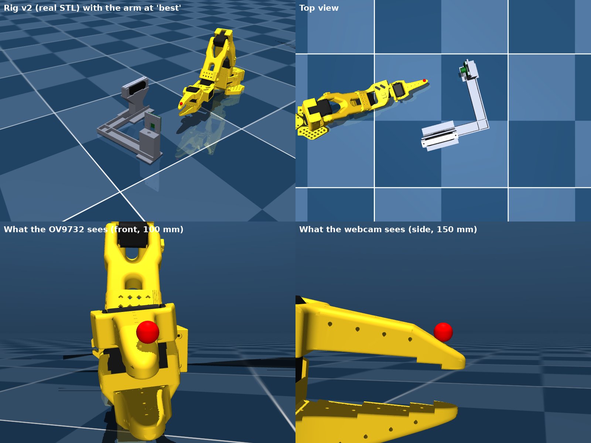
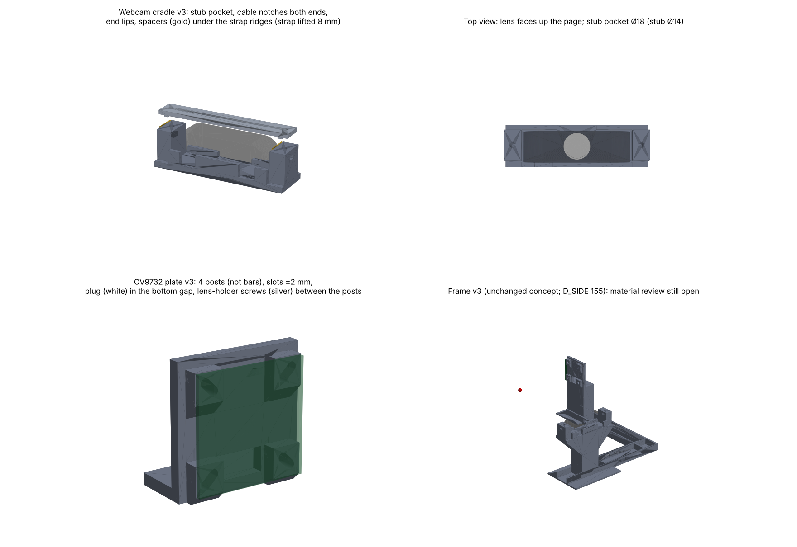
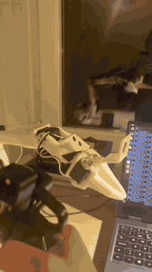
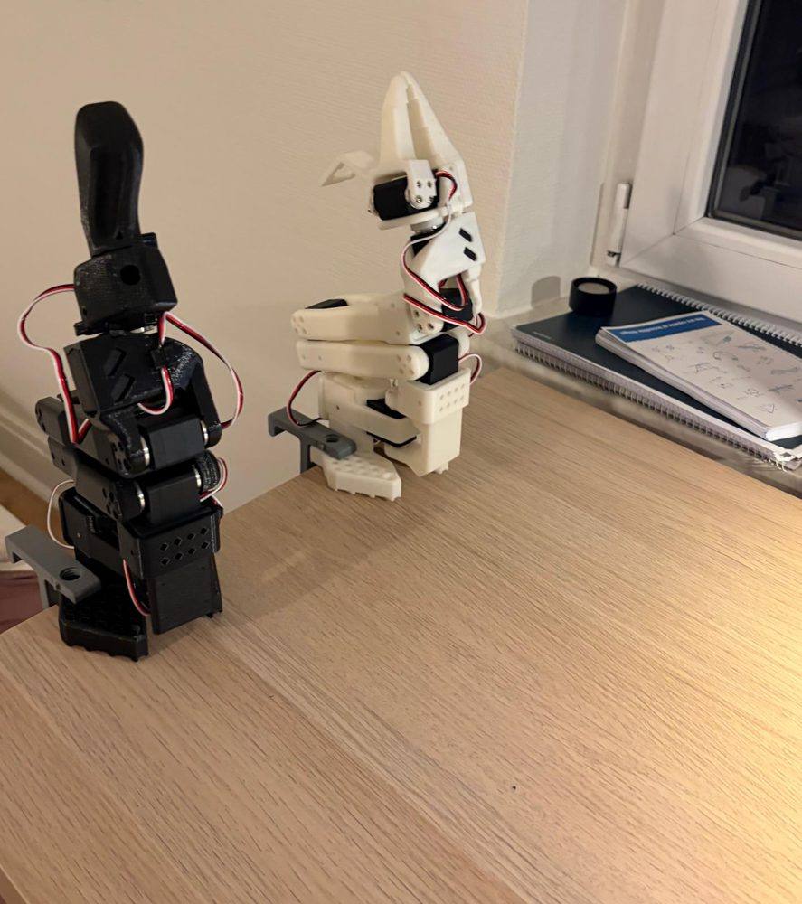

# Progress Log

A dated record of my project, newest first. Each entry covers one session or a span of sessions and shows the engineering process as it happened:

- **The question** the period answered, and the number that made it non-trivial.
- **Reasoning and decisions**: the options, the trade-off argued with physical numbers, the decision and how it was checked.
- **Results and evidence**: what was predicted, measured or built, with units, method and spread.
- **What failed and what it changed**: a prediction or design that failed its test, the diagnosis and the change it forced.
- **Concepts worked through**: the ideas that drove a decision or explained a result, with their short derivation. They record what I studied, not a claim of mastery.
- **Open**: what is still blocked or unfinished.

I started from zero in most of these areas. I draft entries from my private working notes with an AI-assisted workflow and review each one by hand before committing it.

## How I learn: method and references

To develop academic-level thinking for this robot, I consult university robotics courses and use them as references for my exercises and study: Georgia Tech ECE 4560 (Maegan Tucker, a course built on the SO-101), MIT 6.4210 *Robotic Manipulation* (Russ Tedrake) and *Modern Robotics* (Kevin Lynch & Frank Park). I don't use them to copy a course. They give me guidance and set the level, so that I build an academic formation and can then solve problems and make a contribution on my own.

In practice I work every step by hand first: derivations and sketches in my notebook, closed-book recall of the previous lesson, and an explanation of each step in my own words. Only then do I code it and check it against the simulator or the real arm, with real numbers. An AI tutor asks me questions, makes me explain my reasoning and checks my numbers. Each entry lists the sources it used under **Method and references**, and my published exercises are in [`sim/exercises/`](sim/exercises/).

## Entries

> **Format:** entries written from 2026-11-13 on follow the engineering process (the question, reasoning and decisions, results and evidence, what failed and what it changed, concepts worked through, open). Older entries keep the Achieved / Formation / Not achieved format.
>
> **2026-10-25:** project reframed from *error anatomy* to *closing the loop*: same measurements, now followed by a vision-based correction with before/after numbers. Earlier entries keep their original wording.

| Dates | Entry |
|---|---|
| [2026-11-03 to 2026-11-13](#2026-11-03-to-2026-11-13--a-printed-two-camera-measuring-rig-from-requirements-to-a-fit-tested-design) | A printed two-camera measuring rig: from requirements to a fit-tested design |
| [2026-10-20 to 2026-10-24](#2026-10-20-to-2026-10-24--full-3d-forward-kinematics-of-the-so-101-validated-against-mujoco) | Full 3D forward kinematics of the SO-101, validated against MuJoCo |
| [2026-10-14 to 2026-10-20](#2026-10-14-to-2026-10-20--assembly-calibration-and-first-teleoperation-of-the-so-101-pair) | Assembly, calibration and first teleoperation of the SO-101 pair |
| [2026-10-12 to 2026-10-13](#2026-10-12-to-2026-10-13--forward-kinematics-of-the-so-101) | Forward kinematics of the SO-101 |
| [2026-10-06 to 2026-10-07](#2026-10-06-to-2026-10-07--first-simulations-single-joint-dynamics-and-a-6-joint-pose-sequence) | First simulations: single-joint dynamics and a 6-joint pose sequence |
| [2026-09-25 to 2026-09-26](#2026-09-25-to-2026-09-26--leader-arm-configuration-and-preparation-of-the-simulation-track) | Leader-arm configuration and preparation of the simulation track |
| [2026-09-23 to 2026-09-25](#2026-09-23-to-2026-09-25--public-repository-version-control-and-documentation-workflow) | Public repository, version control and documentation workflow |
| [2026-09-19 to 2026-09-23](#2026-09-19-to-2026-09-23--hardware-bring-up-servo-configuration-and-the-communication-layer) | Hardware bring-up: servo configuration and the communication layer |
| [2026-09-12](#2026-09-12--project-planning-and-development-environment-setup) | Project planning and development environment setup |

---

### 2026-11-03 to 2026-11-13 · A printed two-camera measuring rig: from requirements to a fit-tested design

*Question: what instrument can see one point on the gripper to a few hundredths of a millimetre in x, y and z, without relying on the arm's own sensors, and does the printed part fit the real cameras?*

**How I approached the design problem**
1. **Requirements**: what the instrument must do, in words, with no solution named.
2. **Specifications**: a number for each requirement where one can be given, each stating what it rests on (an expectation, a physical argument, or a hard limit). Some requirements cannot be quantified and stay pass/fail.
3. **Ideas**: my own first, sorted by physical principle.
4. **The industry standard**: how repeatability is measured in a lab.
5. **Trade-off**: every idea scored against the requirements.
6. **Deep dive into the chosen idea**, ending in a decision with numbers and its known costs.
7. **Detailed design**, verification, a physical fit test, and a redesign.

The CAD is written as Python (build123d), so every dimension is a named number. Every change goes through 21 geometric checks and boolean intersections with "ghosts" of the real cameras before any file is exported.

**Reasoning and decisions**

*Step 1 — Requirements.* The measurand is the stopping point of one point fixed to the gripper, over ≥ 30 repeats of the same scripted move. Only its scatter matters. The instrument must:
- R1 measure that point's position in 3D;
- R2 measure it relative to a reference that stays fixed during one series (absolute position not needed);
- R3 tell a translation of the gripper from a rotation;
- R4 add little noise compared with the arm's own scatter;
- R5 not drift during a series, and not react to changing room light;
- R6 be independent of the arm's own sensors;
- R7 not touch or load the arm in a way that changes its scatter;
- R8 fit a study desk shared with everything else: compact, light, quick to set up and pack away;
- R9 be cheap.

*Step 2 — Specifications.*

| Req. | Specification | What the number rests on |
|---|---|---|
| R1 | x, y and z, once per cycle | Physics: lift, elbow and wrist_flex turn about horizontal axes, so at a forward pose their errors land in z. 0.30 m lever × one encoder step (0.0015 rad) ≈ 0.46 mm, almost pure z |
| R2 | None needed | Repeatability uses only distances to the cloud's own centre, so a constant offset cancels |
| R3 | Not quantified | A point 8 mm off the roll axis moves under roll, so where the measured point sits matters |
| R4 | Noise ≤ ¼ of the arm's σ → **0.02–0.06 mm per axis** | **Expectation.** No SO-101 figure is published. Comparable arms: RP 0.3–0.9 mm; for a round 3D cloud RP ≈ 3.6σ → σ_arm ≈ 0.08–0.25 mm. Variances add (σ²_meas = σ²_arm + σ²_inst), so ¼ inflates the result by 3 %. The stricter 1/10 is out of reach at this budget. Interim, until my own prediction replaces the literature |
| R5 | Drift ≤ the R4 level over one series; light: not quantified | Derived from R4. The arm's base twisting 0.05° on its clamps already gives 0.26 mm at the tip |
| R6, R7 | Pass/fail | The servo stops when its own encoder reads the goal, so the encoder reports "arrived" by construction. A spring contact presses the gears onto one side of their play every cycle, hiding the backlash to be measured |
| R8 | Footprint ≤ 25 × 50 cm; ≤ 20 cm in one packed dimension; ≤ 2 kg; ≤ 10 min to set up, noise check included | **Limits**: measured desk 140 × 60 cm, ≈ 56 × 60 cm free at the arm |
| R9 | ≤ €30 to buy; owned or printed parts count €0 | **Limit**: budget |

*Step 3 — Ideas.* Twelve ideas sorted by principle, six of them mine: one or two cameras looking at a feature, a close-up microscope, a touch grid, an IMU, a pressure trigger, a spring probe per axis, a very tight hole, a magnet with Hall sensors, a laser lever onto a wall, and an ultrasonic sensor.

*Step 4 — The industry standard.* An ISO 9283 lab set-up puts a precision cube on the gripper and reads it with three non-contact laser displacement sensors at right angles: micrometre level, but hundreds to thousands of euros each. Laser trackers and motion capture are the alternatives.

*Step 5 — Trade-off against the requirements* (✓ meets · ~ borderline · ✗ fails · — not assessed):

| Idea | R1 3D | R4 noise | R7 no load | R8 desk | R9 €30 | Deciding point |
|---|---|---|---|---|---|---|
| One camera | ~ | ~ | ✓ | ✓ | ✓ €0 | Weak along its line of sight: a 0.1 mm shift of a 30 mm feature at 300 mm is 0.6 px sideways, 0.06 px in depth |
| **Two cameras at ~90°** | ✓ | ~ | ✓ | ~ two mounts | ✓ €0 | Each covers the other's weak axis. But one picture is coarser than R4 (marker jitter ≈ 0.05–0.1 mm), so pictures must be averaged; vibration breaks that; and the two cameras differ |
| Close-up / microscope | ~ one plane | ✓ | ✓ | ✓ | ~ €20–40 | Small range, one plane |
| Touch grid | ✗ no z | — | ✗ | ✓ | ~ | Touches the arm |
| IMU | ✗ angles | ✗ drift | ✓ | ✓ | ✓ | Gives angles, not positions |
| Pressure trigger | ✗ | — | ✗ | ✓ | ✓ | Says *when*, not *where* |
| Spring probe per axis | ✓ | ✓ 0.01 mm | ✗ preload | ✗ alignment | ✗ €40–80 | Hides the backlash it should measure |
| Tight hole | ✗ one bit | — | ✗ | ✓ | ✓ | Guides the gripper, i.e. corrects the error → kept as a *task* idea |
| Magnet + Hall | ✓ in theory | ? | ✓ | ~ mm range | ~ €10–25 | Unproven → kept for later |
| Laser lever | ✗ rotation only | ✓ angle | ✓ | ✗ needs a wall | ✓ €5 | Rotation only → kept for later |
| Ultrasonic | ~ one axis | ✗ | ✓ | ✓ | ✓ | One 4 µs timer step ≈ 0.7 mm; ≈ 0.5 mm per °C at 300 mm |
| Lab standard (cube + 3 lasers) | ✓ | ✓ µm | ✓ | — | ✗ | Works in a mm range around one point, so it cannot guide the later correction |

No idea passes every requirement. Two cameras is the only one with no ✗, and its weak point (R4) can be tested and improved, while the others fail on something fundamental. The budget tilted the field towards owned parts. If the cameras fail R4, the budget is revisited rather than the requirement lowered.

*Step 6 — Deep dive into the cameras → decision.*
- **Placement: front + side on one low L-frame.** Front + side rather than top + side: z, where the largest errors are expected, is seen twice, and a top camera needs a cantilever post, the floppiest shape (R5). One frame, because two stands could drift against each other.
- **Distance.** Close is better, since field width ≈ 2d·tan(½ field of view). How close is set by focus, so I ran a ruler test: a tape measure as target, raw frames at 8, 10, 12, 15 and 17 cm, pixels counted between cm marks, sharpness from the variance of the Laplacian.
  - The webcam has a **fixed-focus lens**. At 8 cm it would give 0.042 mm/px, but it is blurred there. Sharpness was 50 / 116 / 82 at 12 / 15 / 17 cm, so it is usable only from about 15 cm, with best focus at 15–16 cm. Side distance: **155 mm** (≈ 0.085 mm/px, 157 mm field).
  - The board camera (OV9732) has a screw focus and is crisp at 10 cm: 0.115 mm/px over 147 mm. Front distance: **100 mm**.
- **Assignment.** The finer webcam goes on the side, watching x, the arm's hardest-to-read axis. The board camera goes in front for y and z.
- **What this choice costs.**
  - It is far less precise than the lab standard (micrometres there; 20–60 µm is the target here).
  - Each camera is 0.085–0.115 mm per pixel, coarser than R4. The method depends on sub-pixel localisation (¼–⅕ px) and on averaging N pictures (σ/√N), which only works if the frames are independent; vibration or light flicker break that.
  - The two cameras differ in resolution and focus, so each needs its own calibration, and the front camera is ≈ 1.4× coarser.
  - Exposure, white balance and focus must be locked by hand.

  These are the risks the noise test must settle.

*Step 7 — Detailed design.*
- **Clamping a camera without loading it.** My first idea was to squeeze 1.5 mm of rubber by 0.8 mm. Thin confined rubber is nearly incompressible, so that squeeze needs ≈ 1800 N. I replaced it with a hard stop, so bolt torque never reaches the camera, plus a PLA strap as a leaf spring on two 1 mm pivot ridges. A 0.5 mm bow gives 12 N at 8 MPa, below PLA's ≈ 12 MPa creep limit.
- **Tolerance rule: only the cameras fit, everything else is clearance.** Dimensions known only to ±2 mm became adjustable, with printed spacers setting the clamp height. The camera board is held by an exact constraint: one round datum hole, one slot along x, one along z, one free post. My earlier four 45° slots absorb only equal errors in both directions; the boolean check failed 11 of 15 pitch combinations, and the new pattern passes all 15.

**Results and evidence**

> [!IMPORTANT]
> **Milestones**
> - **First printed parts of the measurement rig fit-tested against the real cameras.** I measured every misfit in millimetres and turned it into the numbers of the next version (v4).

- Design v4: [`hardware/rig/`](hardware/rig/) (geometry script, STL and STEP files). The full frame (121 g, 5 h 38 in the slicer) has been ordered from a fab lab.
- I estimated what a 2 N bump does to the instrument: front tower 2.4 µm, side tower 2.2 µm, i.e. 4–6 µm of apparent motion at the gripper. A 1 °C change moves the 150 mm side arm by 10 µm. Both are below the 20–60 µm noise target. Free-standing, the frame tips at 1.9 N and slides at 1.3 N, so 400 g of ballast is part of the design (6.7 / 3.7 N).

  
   
  <em><b>Figure 1.</b> Simulation of the public SO-101 model with the rig's real STL (v2) placed next to it at the test pose. Top: overview and top view. Bottom: what the front camera (100 mm) and the side camera (150 mm) see; the red dot is the measured point.</em>

  
   
  <em><b>Figure 2.</b> CAD of rig v3: webcam cradle with strap and spacers, top view of the stub pocket, the camera-board plate on four posts with slots, and the L-frame. v4 changes only the webcam cradle's height and depth.</em>

**What failed and what it changed**
- **Re-verification against the real cameras (v2 → v3)** found design errors that the checks on the drawings had missed:
  - the webcam's mounting stub is on the bottom, not the back (the camera would have sat 6 mm high);
  - the strap presses at the two ends of the camera's flat top, not mid-span (stiffness ≈ 25 N/mm, not 9);
  - the board's standoff bars sat under two lens-holder screw heads;
  - the 45° slot pattern above.

  Rule since then: a check that passes only at the nominal dimension is not a check.
- **Fit test of the printed parts (v3 → v4).**
  - Webcam height: assumed 24 ± 2 mm; measured 25.8 ± 0.4 mm from photos, scaled by known part dimensions and cross-checked between two views. The strap therefore bowed ≈ 4 mm instead of 0.5, i.e. ≈ 55 N and ≈ 45 MPa, far above creep. Fix: pillars 21.5 → 24.3 mm (= camera 25.8 − ridge 1 − bow 0.5).
  - Pocket play: ≈ 1 mm front to back let the camera tip 2–4°. Fix: pocket 22 → 21.2 mm, 0.4 mm per wall rather than 1 mm, because printed pockets come out ≈ 0.3 mm small. That leaves ≈ 0.4 mm of play and < 1° of tip.

**Concepts worked through**
- Why does the webcam offer raw 1080p only at 5 fps? Data rate = width × height × bytes per pixel × fps = 1920 × 1080 × 2 × 5 ≈ 20.7 MB/s, about what USB 2 carries. Compressed MJPEG reaches 30 fps but blurs edges, so measurements use raw single frames.
- How does a leaf spring give a defined clamp force? Simply supported, k = 48EI/L³, and the stress grows as E·t·(bow)/L². Fixing the bow with spacers fixes the force, whatever the exact camera height; a thicker strap raises the stress at the same bow.
- Why three bolts and not four on the camera board? Each tight hole forces a coincidence. Four over-constrain the board, so one bad pitch jams it. One datum plus one slot fixes position and rotation; the rest must be free.
- Side work (microcontroller): what turns a `.c` file into bytes on a chip? The compiler makes machine code with blanks for calls into other files. The linker gives every function an address and fills the blanks, producing an `.elf` (kept on the laptop for debugging) and a `.bin` (the raw bytes that are flashed). My first ESP32 test build: 125,920 bytes. This prepares a servo step-response bench in C.

**Open**
- The v4 webcam cradle is untested (only v3 was printed), and the full frame is not yet assembled.
- Whether sub-pixel localisation and averaging reach 0.02–0.06 mm with these cameras, given vibration and light, is unknown until the noise test.

---

### 2026-10-20 to 2026-10-24 · Full 3D forward kinematics of the SO-101, validated against MuJoCo

**Method and references**
- My exercises and study follow reference robotics courses. They give me guidance and set the academic level of thinking I aim for on this robot: K. Lynch & F. Park, *Modern Robotics* (2017), §4.1.1 (product of exponentials); Georgia Tech ECE 4560 (Fall 2025), lectures 2–4 (rotations and transforms); R. Tedrake, *Robotic Manipulation* (MIT), Ch. 3.
- I work every step by hand first: derivations and sketches in my notebook, closed-book recall of the previous lesson, and an explanation of each step in my own words. Only then do I code it. An AI tutor asks me questions, makes me explain my reasoning and checks my numbers.
- Each result is then checked against the official SO-101 model in MuJoCo, using real numbers.

**Achieved**

> [!IMPORTANT]
> **Milestones**
> - **First full 3D forward kinematics of the SO-101 (5 joints, base to gripper), validated against MuJoCo**: maximum position error 1.3 × 10⁻¹² mm over 20 random poses within the joint limits, i.e. floating-point level (position only; orientation not yet compared).

- Code: [`ex5_so101_fk3d.py`](sim/exercises/lesson_B/ex5_so101_fk3d.py). I wrote it, thought it through and designed its structure: rotation functions with a sign per joint, one 4×4 transform per joint, a running product from the base outward, and a comparison with MuJoCo. AI helped me find errors and helped with some vocabulary and code, and it asked me questions that made me explain each part. I tested it in increasing difficulty: zero pose, pan only, one joint at a time, then 20 random poses.
- I diagnosed and fixed a teleoperation fault: after re-plugging, the follower went limp while the leader moved by itself. Linux numbers serial ports in plug order, so the two boards had swapped names and the leader was receiving the motion commands. I isolated the cause by connecting one board at a time.

**Formation — questions worked through**
- Where do the rotation matrices come from? Write a point as (x, y) = |r|(cos φ₀, sin φ₀) and rotate it by α. Expanding cos(φ₀ + α) and sin(φ₀ + α) with the addition formulas gives x′ = x cos α − y sin α, y′ = x sin α + y cos α, which is R_z. Each column shows where an axis lands (at 90°, R_z sends x → y). The cyclic order x → y → z → x then gives R_x and R_y, with R_y's minus sign in the bottom-left. The columns are orthonormal (Rᵀ R = I, det = +1), so lengths are preserved.
- How does a joint's axis direction fix the sign of its angle? A rotation by θ about −axis equals a rotation by −θ about +axis. From the model's axis vectors: pan (0, 0, −1) → R_z(−θ), lift/elbow/wrist_flex (0, 1, 0) → R_y(+θ), wrist_roll (−1, 0, 0) → R_x(−θ), each checked in MuJoCo. A wrong sign mirrors the arm: the tip lands at y = +0.1763 m instead of −0.1763 m at pan 30°, 35 cm apart.
- Why does a joint need a 4×4 transform rather than a 3×3 matrix? R turns vectors about the origin only, so a point is turned about an axis through c as p′ = c + R(p − c). For the elbow axis point at pan 30° this gives (0.0802, −0.0450) m, matching MuJoCo, while R·p alone lands 2 cm off. Rewritten, p′ = R p + t with t = c − R c, and a constant shift cannot come from a matrix product (R·0 = 0). Appending a 1 to the point puts t in a fourth column: T = [R t; 0 1].
- How does the tip follow from the rotation of every joint about its own axis? tip(θ) = T_pan(θ₁) T_lift(θ₂) T_elbow(θ₃) T_wflex(θ₄) T_roll(θ₅) [p₀; 1], where p₀ is the tip at the zero pose. The matrices act right to left, so the joint nearest the tip turns first while every joint nearer the base is still at zero. Each axis point c therefore keeps its zero-pose value, read once from the model, and moving the arm means calling the same function with new angles. The product turns each joint's shift by the joints nearer the base (combined shift R_pan t_lift + t_pan). Multiplied in the reverse order, the elbow point at pan 30° + lift 30° is 29 mm off. Formal name: product of exponentials, space form.

**Not achieved / open**
- The orientation half of the validation is not done: I have not yet compared the gripper's rotation with MuJoCo's.
- The serial ports still have no stable per-device names, which is what allowed the teleoperation fault.

---

### 2026-10-14 to 2026-10-20 · Assembly, calibration and first teleoperation of the SO-101 pair

**Achieved**

> [!IMPORTANT]
> **Milestones**
> - **First teleoperation of my SO-101 pair**: the follower copies the hand-guided leader on all 6 joints at 59.1 Hz (target 60 Hz), 0 of 4769 control ticks over budget.
> - **I assembled and calibrated both arms**, 6/6 joints each.

- I found the same bus fault on both arms: servos beyond ID 2 did not answer, which placed the break in the servo 2 → 3 cable. I re-soldered a broken connector pin.

  
   
  <em><b>Figure 1.</b> First teleoperation on hardware: the follower copies the hand-guided leader joint by joint, 60 Hz loop, 5° per-tick safety cap. Phone video, 11.4 s.</em>

  
   
  <em><b>Figure 2.</b> Assembled leader (front) and follower, clamped about 10 cm apart in the same orientation.</em>

**Formation — questions worked through**
- Why must a joint's travel never cross the encoder's 4095 → 0 wrap, and how does calibration prevent it? The servo computes error = goal − present on a straight number line, so a 1.4° move from 4090 to 10 reads as −4080 counts ≈ −358°. Calibration sets a homing offset, reported = (raw − offset) mod 4096, with offset = raw − 2047 at the pose the arm is held in, so that pose sits opposite the wrap (raw 4038 → offset 1991). The margin left on each side is (4096 − travel)/2: 855 counts ≈ ±75° for shoulder_lift.
- How do two arms with different raw counts agree on "the same position"? Each arm's calibration maps counts to degrees, with 0° = (min + max)/2 of the recorded travel and degrees = (count − mid) · 360/4095; degrees are what is sent. Example: leader 1490 → −45.3° → follower 1442.
- Why does a position servo trail a moving target? Its torque is proportional to the position error, so following at speed ω needs an error that grows with ω. Measured on one fast wrist move (preliminary): 5–6° behind at ≈ 50°/s, a lag of ≈ 0.11 s, of which communication is ≲ 20 ms.
- Does a learned imitation policy need inverse kinematics? No: the human solves it by moving the leader. A scripted inverse-kinematics grasp does, and its spread contains only mechanical and control error, so comparing it with the policy isolates the policy's share.

**Not achieved / open**
- I have no commanded-vs-measured data on the real follower yet.
- The re-soldered pins sit on the most-moved shoulder cable of both arms, a reliability risk.

---

### 2026-10-12 to 2026-10-13 · Forward kinematics of the SO-101

**Achieved**

> [!IMPORTANT]
> **Milestones**
> - **My first forward-kinematics model of the real SO-101**: the planar chain shoulder_lift → elbow_flex → wrist_flex predicts the gripper position of the MuJoCo model on 10 random poses with a max error of 3 × 10⁻¹³ mm.

- Method: I read the joint positions and axes from the MuJoCo model to get the arm's real geometry: link lengths 0.1160 / 0.1350 / 0.1594 m and the angle of each link at zero encoder reading (+76.03°, −73.82°, −5.05°). I derived the model by hand; the comparison script was written by AI.
- I wrote n-joint forward kinematics in NumPy: a cumulative sum turns relative joint angles into link directions, then one matrix product [cos φ; sin φ] (2 × n) · L (n) gives the tip (x, y). I checked it on two hand-solved poses, both (0.10, 0.10) m.

**Formation — questions worked through**
- How does the tip position follow from the joint angles? Each encoder measures its link relative to the previous one, so link k points along the running sum of angles: x = Σ Lₖ cos(θ₁ + … + θₖ), y = Σ Lₖ sin(θ₁ + … + θₖ).
- Why can one target have two joint solutions? The elbow lies on a circle of radius L₁ around the base and of radius L₂ around the target; two circles meet in 2, 1 or 0 points (elbow-up, elbow-down, or unreachable).
- Why is full stretch the worst place for a task? For two equal links, |tip|² = 2L² + 2L² cos φ₂ = 4L² cos²(φ₂/2), so r = 2L cos(φ₂/2) and dr/dφ₂ = −L sin(φ₂/2). With L = 0.10 m: 1.23 mm of radial motion per elbow degree at 90° bend, 0.03 mm at 2°. Near the stretched pose (a singularity) the tip barely responds to the joints.
- Why does kinematics follow the line between joint axes, not the shape of the part? On the SO-101 the elbow axis sits 2.8 cm to the side of the upper arm, which tilts the effective link by 14°; ignoring it misplaces the elbow by about 2.8 cm.

**Not achieved / open**
- I had not started full 3D kinematics (adding shoulder_pan and wrist_roll).

---

### 2026-10-06 to 2026-10-07 · First simulations: single-joint dynamics and a 6-joint pose sequence

**Achieved**

> [!IMPORTANT]
> **Milestones**
> - **My first simulation commanding all 6 SO-101 joints together**, recorded and plotted per joint (commanded vs. actual).
> - **First choreographed motion:** 7 poses (ready, reach, grasp, lift with wrist roll, reach, release, home), no floor contact, largest arm-joint tracking gap 0.013 rad.

- My first hand-written simulation model: a one-joint pendulum stepped from Python (simulated swing period ≈ 1.2 s).
- I inspected the SO-101 model from Python: 8 bodies, 6 joints, 6 position actuators, 31 geometry elements.
- Simulated 0.5 rad step on one joint: overshoot to 0.627 rad, settled by ≈ 0.43 s, 0.0007 rad residual offset.
- Tracking error vs. move duration (0.5 rad move): largest gap 0.0047, 0.023, 0.33 rad at 2.0, 0.5, 0.1 s.
- These are simulation results only. The motor parameters are borrowed from another robot model, so the control error has to come from the real arm.

  
   
  <em><b>Figure 1.</b> Simulated 7-pose sequence on the public SO-101 MuJoCo model: ready → reach right (gripper opens) → grasp → lift with wrist roll → reach left → release → home. Linear interpolation of joint targets at 50 Hz.</em>

  
   
  <em><b>Figure 2.</b> Commanded (dashed) vs. actual (solid) angle of each joint during the sequence in Figure 1. The two curves overlap: largest gap 0.013 rad on the arm joints, 0.04 rad on the gripper during its fast moves.</em>

**Formation — questions worked through**
- How is a robot described for a physics engine? (MJCF nested bodies, joints, geometry; visual vs. collision shapes; units)
- How is a simulation driven from Python? (compiled model vs. state, time stepping, actuator targets, live viewer)
- How are revolute-joint sign conventions defined unambiguously? (joint axis, right-hand rule, parallel axes forming a planar sub-chain)
- Which physical effects make up a simulated servo joint, and what does each contribute? (gravity load, link inertia, reflected rotor inertia J·N², feedback "spring", damping, torque limit)
- Why does a position-controlled joint overshoot when its torque saturates? (proportional feedback, bang-bang behaviour, momentum carrying past the target)
- How does interpolating joint targets trade motion speed against tracking error? (linear interpolation, 50 Hz targets on 500 Hz physics)
- Why should interpolation track progress through the move rather than add a constant increment? (α as fraction completed 0→1, accumulated rounding, real-clock timing)
- How is a multi-joint simulation recorded and analysed in Python? (per-step arrays stacked into a time × joint table, view vs. copy, column slicing, stacked plots)
- How are simulation frames rendered offscreen and compressed for documentation? (fixed camera, GIF export, cropping, frame skipping, palette reduction)

**Not achieved / open**
- No hardware progress: I had not assembled the follower, and the leader IDs were still unverified.
- I had not started forward kinematics.

---

### 2026-09-25 to 2026-09-26 · Leader-arm configuration and preparation of the simulation track

**Method and references**
- Backbone: Georgia Tech ECE 4560 (Maegan Tucker), a course built on the SO-101. I use it as a reference, not step by step.
- Where I deliberately differ: simulation first, forward kinematics and sensitivity before inverse kinematics, and a prediction vs. measurement in every exercise.
- Supplements: MIT 6.4210 *Robotic Manipulation*, Chapter 3; Northwestern *Modern Robotics* (Lynch & Park).
- Simulation model: TheRobotStudio's public SO-101 MuJoCo model (SO-ARM100 repository).
- Learning-design evidence: de Jong, Linn & Zacharia (2013), *Science*, on combining physical and virtual laboratories.

**Achieved**
- Leader arm: I matched 6/6 servos to their joints by gear ratio and checked them against the official bill of materials.
- I assigned leader IDs 1–6 with the single working board; not yet confirmed by a bus scan.
- I corrected my earlier "leader blocked" status: ID assignment needs one board; two are needed only for teleoperation.
- I loaded the public SO-101 simulation model in MuJoCo 3.14 in a test environment; joint names and order match LeRobot.
- I computed the tip shift per encoder step (0.088°) from the model: 0.25–0.54 mm, depending on joint and pose.
- I found that the stock gripper collision shapes cannot hold a cube in simulation.

**Formation — questions worked through**
- On a shared servo bus, which operations need one adapter, and which need two at once? (daisy-chain addressing, ID assignment vs. teleoperation)
- How do supply voltage and gear reduction set a servo's torque and backdrivability? (three leader gear ratios, 5 V supply on 7.4 V-rated motors)
- How does joint encoder resolution translate into end-effector position error, and why does it depend on pose? (arc length, Jacobian)
- Why are forward kinematics and the Jacobian a prerequisite for an error budget, ahead of inverse kinematics?
- How should simulation, programming, kinematics and physical assembly be sequenced? (combining physical and virtual laboratories)
- How can control logic be shared between a simulated and a physical arm? (adapter layer, radians vs. degrees, simulated vs. real time)
- What happens when a command line runs a Python module? (shell search path, interpreter flags, argument passing, conda environments)
- Through which software layers does one servo command travel? (Python packet builder, serial library, kernel driver, board and servo firmware)

**Not achieved / open**
- Leader IDs not verified; I still needed a second driver board to run both arms together.
- I had not started physical assembly; I deferred it deliberately to avoid reassembly and recalibration.

---

### 2026-09-23 to 2026-09-25 · Public repository, version control and documentation workflow

**Achieved**
- I created the public repository with a documented structure: overview, progress log, and a README per folder.
- I excluded my private working notes and tool configuration from version control, and verified the exclusion before publishing.
- I wrote the public objectives document, including a researched overview of the current physical-AI landscape.
- I installed and configured an AI coding agent with project instructions and an approval-gated routine for this log.

**Formation — questions worked through**
- How does a Unix shell locate executables, and when do startup-file changes take effect? (search path, symbolic links, per-shell startup files)
- How does version control model a project's history? (working directory, staging area, commits)
- What distinguishes a local repository from a hosted remote?
- Why does untracking a file not remove it from history, and what can ignore rules not do?
- How are public engineering repositories conventionally structured? (reference layouts, per-folder documentation, changelog conventions)
- How does an AI coding agent act on a filesystem, and how is its authority bounded? (permission gating, standing instructions, skills)

**Not achieved / open**
- An early version of the repository included my private notes in its history; I rebuilt the repository with a clean history.
- The routine for drafting this log needed several redesigns before the first entry.
- No hardware progress: the leader arm was still blocked and assembly had not started.
- I have not yet chosen a license for the repository.

---

### 2026-09-19 to 2026-09-23 · Hardware bring-up: servo configuration and the communication layer

**Achieved**
- Follower arm: I assigned unique bus IDs to 6/6 servos, configuring one servo at a time.
- I isolated a defective driver board by substitution: 1 of 2 boards powered and enumerated but relayed no data.
- I filed a warranty claim for the defective board and identified a low-cost backup adapter.
- I configured serial-port access persistently through group membership.

**Formation — questions worked through**
- How is a robotic manipulator decomposed into functional layers, and how do these map onto the error budget?
- How do joint angles determine end-effector position? (forward kinematics, at the intuition level)
- How is information physically transmitted between a computer and a peripheral? (UART bit timing, baud rate, USB differential signalling)
- How does a motor command become bytes on a shared servo bus? (packet structure, device IDs, registers, checksum)
- How does the Linux kernel expose a hardware device to user programs? (character devices, major/minor numbers, udev)
- How does a Unix shell resolve variables, programs and access rights? (environment variables, search path, permissions, groups)

**Not achieved / open**
- The leader arm was not configured; it was blocked on a second working driver board.
- A diagnostic script I wrote briefly mimicked a hardware fault; the cause was a silently caught software error.
- I had not started physical assembly and calibration.

---

### 2026-09-12 · Project planning and development environment setup

**Achieved**
- I estimated a semester time budget against my course load; single-semester completion is a stretch goal.
- I set my working method: concepts built one at a time from physical intuition, alongside hands-on work.
- I revised the camera setup to two cameras (wrist-mounted and overview) and sourced the hardware kit.
- I installed Ubuntu 24.04 LTS as dual-boot, with NVIDIA GPU drivers for later policy training.
- I installed LeRobot with Feetech servo support in a dedicated Python 3.12 environment and verified the import.
- I installed my development tooling: version control, code editor, Python package manager.

**Formation — questions worked through**
- Where does the boundary between hardware and software lie? (transistors as switches, bits, memory from feedback latches)
- How does a processor execute a stored program? (instruction sets, assembly, fetch–execute cycle)
- What is an operating system kernel, and what role do device drivers play?
- How do programs communicate with peripherals? (device protocols such as Modbus, memory-mapped I/O)
- Why is Linux the prevailing platform for robotics development? (ecosystem, real-time kernel extensions, file-based device access)
- How are Python dependencies isolated per project? (conda environments, interpreter version requirements)

**Not achieved / open**
- My first LeRobot install failed: third-party guides specify Python 3.10, while current LeRobot requires 3.12 or newer.
- I had not yet evaluated the measurement method (camera fiducials vs. mechanical fixture).
- I had not yet fixed the task geometry or the choice of policy.
