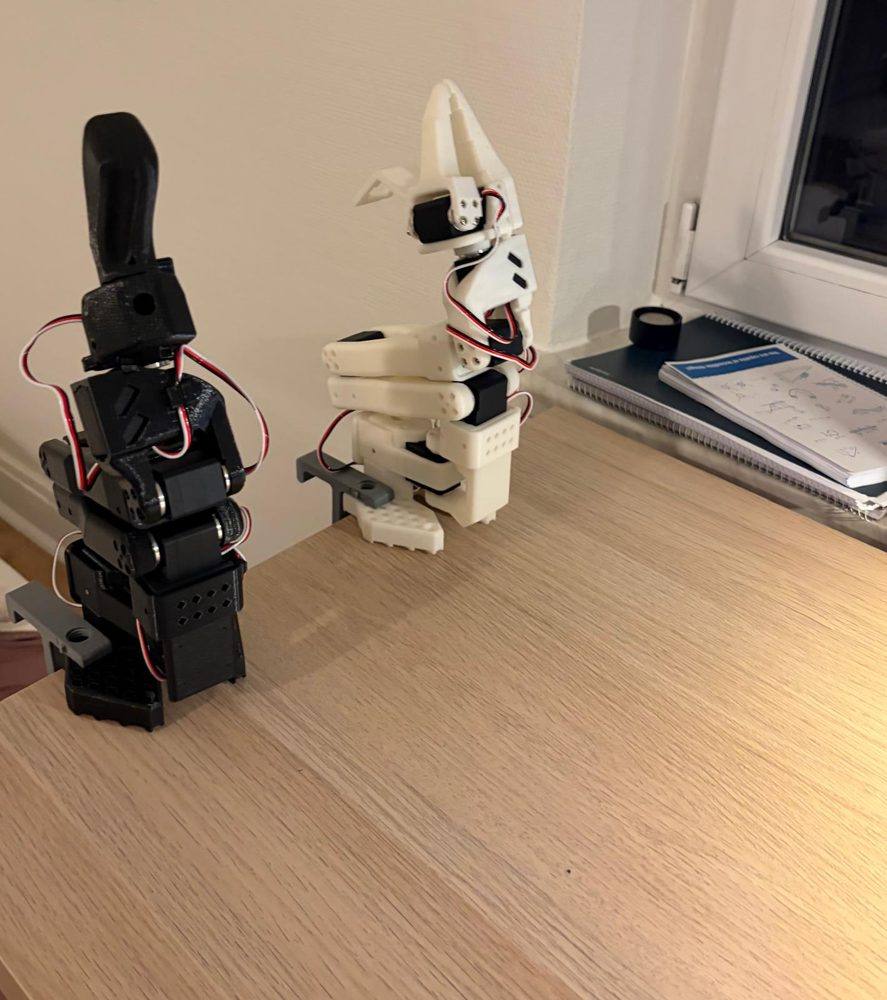
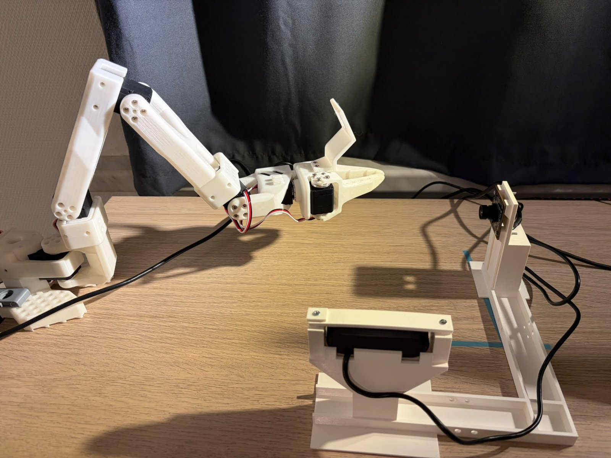

# SO-101: Closing the Loop

A €200 open-source arm misses its placement target by some fraction of a millimetre. This project measures that miss with an independent camera rig, dissects where it comes from (backlash and compliance in the joints, the servos' control, and, later, a learned policy), and then closes the loop: a vision-based correction built on the same rig, with the repeatability measured before and after. The error budget is the diagnosis; the correction is the fix.

**Jump to:** [What and why](#what-this-project-is-and-why) · [Objectives, status and timeline](#objectives-status-and-timeline) · [Method and references](#method-and-references) · [About me](#about-me-and-why-i-took-this-on) · [Where to find what](#where-to-find-what)



## What this project is, and why

The SO-101 is a 5-DOF arm with a gripper (six Feetech STS3215 servos), built by The Robot Studio and Hugging Face for the LeRobot framework. It has become the standard low-cost platform for learning robot manipulation, but I found no published figure for how precisely a stock one actually places an object. A question asking for that number in the official hardware repository is still unanswered.

When the arm misses, the miss has several possible sources, and they call for different fixes:
- **mechanical**: backlash and compliance in the joints and gearboxes;
- **control**: how the servos are tuned (a stiff or soft position loop, a dead band);
- **policy**: the learned imitation policy (ACT), if one is driving the arm.

An **error budget** splits the total miss into these shares, so that the fix targets the source that actually dominates. I found no published multi-source error budget for an arm in this class, and no closed-loop correction with before/after numbers. Doing both on the same rig is the contribution. More on the prior work and the gap: [`docs/about.md`](docs/about.md#why-this-project).

## Objectives, status and timeline

**Objectives**
1. Measure the placement repeatability of the SO-101 with ground truth independent of the arm's own sensors.
2. Decompose that miss into its mechanical and control shares (and, as a stretch phase, the policy's), predicted first and then measured.
3. Close the loop: a vision-based correction driven by the same camera, with repeatability measured before and after.

> **Status (2026-11-23):** both arms are assembled, calibrated and teleoperating, and full 3D forward kinematics is validated against the MuJoCo model. The independent two-camera measuring rig ([`hardware/rig/`](hardware/rig/), v4) is printed and has been set up next to the arm for the first time: the first camera views showed what the next iteration must fix (a placement reference, the webcam's working distance, lighting on white plastic). **No repeatability has been measured yet.** The full dated record is in [`PROGRESS.md`](PROGRESS.md).



*First prototype of the measuring rig (v4, 23 Nov 2026): the arm holds the test pose; the webcam (nearest tower) watches the gripper from the side, the small board camera (right tower) looks along it.*

**Timeline.** The project is split into gates. Each gate ends in a result that can be shown, so the project is complete up to whichever gate it reaches.

| Gate | Target date | Result | Status |
|---|---|---|---|
| Groundwork | Sep–Oct 2026 | Arms assembled and calibrated; servo bus understood; forward kinematics validated in simulation | ✅ Done |
| **G1 First measured miss** | Dec 2026 | Scripted motion to one pose, 30 cycles, measured by a camera rig; repeatability per ISO 9283, with a written prediction first | Next |
| **G2 Anatomy** | Jan 2027 | Where the miss comes from: backlash, servo stiffness under load, per-joint sensitivity, quantisation; predicted vs measured budget | Planned |
| **G3 Closing the loop** | Mar 2027 | Vision-based correction step; repeatability before and after on the same pose | Planned |
| G4 Stretch | Apr 2027 on | A learned ACT policy as a further condition; a ROS 2 wrapper | Only if time remains |

## Method and references

**The approach.** I measure the same task under progressively more complex conditions:
1. **Scripted motion** (no learning), which gives the raw mechanical + control repeatability.
2. **A bench-level servo backlash test**, which isolates the mechanical share.
3. **A trained policy**, which adds the policy's own variance on top. This is a stretch phase, run only if time remains after step 4.
4. **Close the loop**: a vision-based correction using the measurement camera, repeatability measured before and after.

If these error sources are roughly independent, their variances add, and each contribution can be estimated by subtraction. That independence is an assumption to check against the data, not something to take for granted.

**Rules I hold myself to**
- **Independent ground truth.** Precision is never judged with the arm's own encoders or cameras, only with a separate measurement rig.
- **ISO 9283-style statistics.** Repeatability is reported as RP = l̄ + 3S over repeated cycles to the same pose.
- **Predict before measuring.** Every measured number gets a written prediction first; the gap between them is part of the result.
- **Simulation alongside hardware.** Each derivation is checked against the official SO-101 model in MuJoCo before it is trusted on the real arm.

**How I learn it.** I use university courses as references: Georgia Tech ECE 4560 (a course built on the SO-101), MIT 6.4210 *Robotic Manipulation* and Lynch & Park's *Modern Robotics*. I derive every step by hand, then code it and check it. Details: [how I learn](PROGRESS.md#how-i-learn-method-and-references).

**Key prior work** (full citations in [`docs/about.md`](docs/about.md#references)):
- Repeatability of low-cost arms with external ground truth: PyRobot / LoCoBot (0.33–0.58 mm), HELENE (0.87 mm), a capstan-drive arm (0.29–0.59 mm). None splits the error into its sources.
- Backlash of the STS3215 servo itself: 0.62° unloaded, 1.30° under about 0.3 kgf (Kotov, *HardwareX* 2026).
- A benchmark of learned policies on the SO-101 that attributes most failures to execution, without measuring any hardware quantity (Yu & Qiu, arXiv:2606.08881).

## About me, and why I took this on

I'm David, a master's student in Mechanical Engineering (Robotics & Mechatronics) at KU Leuven, after a bachelor's at IST Lisbon. Before this project I had worked on a pneumatic soft snake robot and, during an internship at Siemens, built [describe2model](https://github.com/tucasteixeira-debug/describe2model), a framework linking control logic with physical models.

When I started, the strongest thing I had was the way I think: an academic formation that taught me to reason through a problem carefully. But I was honest with myself about what I lacked. I didn't yet have the maturity this field asks for, in many different ways: practical skills, knowledge, parts of the academic formation itself, AI and machine learning, simulation, and the experience of making a real system work. This project is my attempt to close at least part of that gap, by taking ownership of one hardware and software project from the first screw to the final number.

It works on me at several levels at once:

1. **Academic.** Forward and inverse kinematics, and the physics and mathematics behind how the robot actually moves, worked through with university courses as my reference: Georgia Tech ECE 4560, MIT 6.4210 *Robotic Manipulation* and Lynch & Park's *Modern Robotics*.
2. **My own questions.** A free space to dig into whatever I'm curious about, even when the question feels silly. For example: how can one piece of hardware (a computer) command another (a servo) just because I typed something on a keyboard? Following that question took me through software, the operating system, serial communication and the packets on the servo bus.
3. **Coding.** Python and the MuJoCo simulator for now, and C++ later for the measurement rig.
4. **Hardware integration.** Designing and building the independent measurement rig, integrating its cameras into the whole build, and making the hardware and the software work together as one system.
5. **Design thinking.** Going from requirements to specifications, ideas, trade-offs and finally a solution, and being able to defend each decision. The rig, the test protocol and the correction are all chosen this way.

Along the way, AI agents act as my tutor and reviewer: they ask me questions, make me explain my reasoning and catch my mistakes.

More on the motivation, the field and my starting point: [`docs/about.md`](docs/about.md).

## Where to find what

| If you want… | Go to |
|---|---|
| What has been done so far, with dates, numbers, figures and what I studied | [`PROGRESS.md`](PROGRESS.md), newest first |
| The motivation, the prior work with full citations, and my goals | [`docs/about.md`](docs/about.md) |
| The final report | [below](#the-report); not written yet |
| My study exercises (derived by hand, coded, checked in simulation) | [`sim/exercises/`](sim/exercises/) |
| Simulation setup (MuJoCo, the official SO-101 model) | [`sim/`](sim/) |
| The physical platform, its bring-up and the planned measurement rig | [`hardware/`](hardware/) |
| The experimental conditions and, later, their results | [`experiments/`](experiments/) |
| Code for the real arm, measurement and analysis | [`src/`](src/) |

```
.
├── README.md          you are here
├── PROGRESS.md        dated log: achieved, studied, still open
├── docs/              about.md, figures in media/, the report later
├── hardware/          platform, bring-up status, measurement rig
├── sim/               MuJoCo setup and study exercises
├── experiments/       one folder per condition (01–05)
└── src/               project code
```

Every folder has its own README explaining what goes in it and what state it's in.

## The report

*Not written yet. This section is reserved for it.* The report will live in [`docs/`](docs/) and will be linked here once the measurements exist. Planned contents:

1. **The question and the task**: the placement task and what counts as an error.
2. **Method**: the independent measurement rig, ISO 9283-style statistics, and how errors in the joints propagate to the tip through the kinematics.
3. **Results per condition**: scripted motion, servo backlash, learned policy ([`experiments/01`–`03`](experiments/)).
4. **The budget**: each source's share, with uncertainties.
5. **The intervention**: what was changed and the measured improvement ([`experiments/04`](experiments/)).
6. **Closing the loop**: the correction and its measured effect ([`experiments/05`](experiments/)).

## How this log is written

I draft the log entries from my private working notes with an AI-assisted workflow: Claude Code and a custom documentation skill. I review and approve each entry by hand before it is committed.
